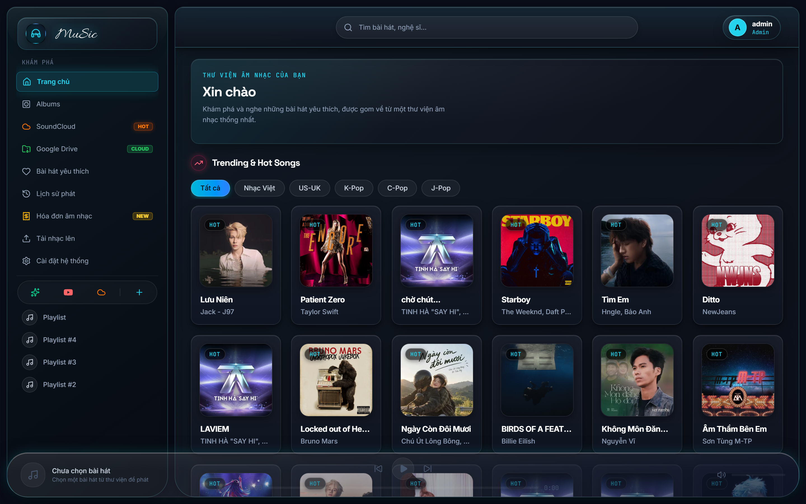
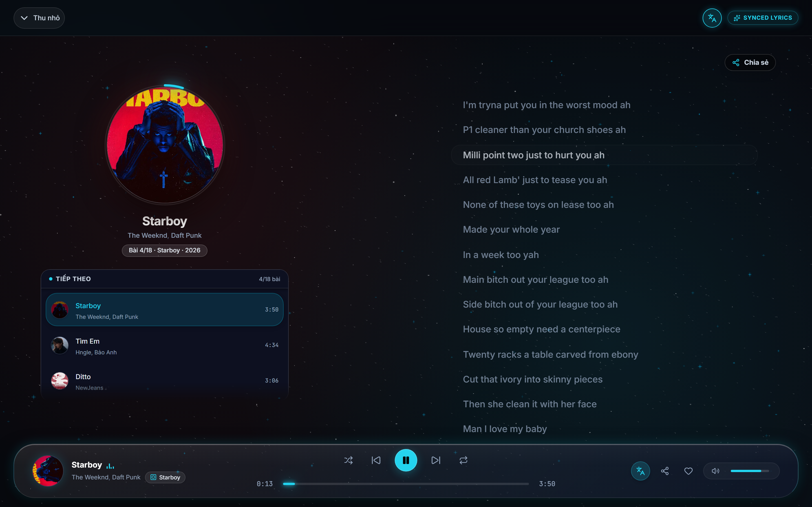
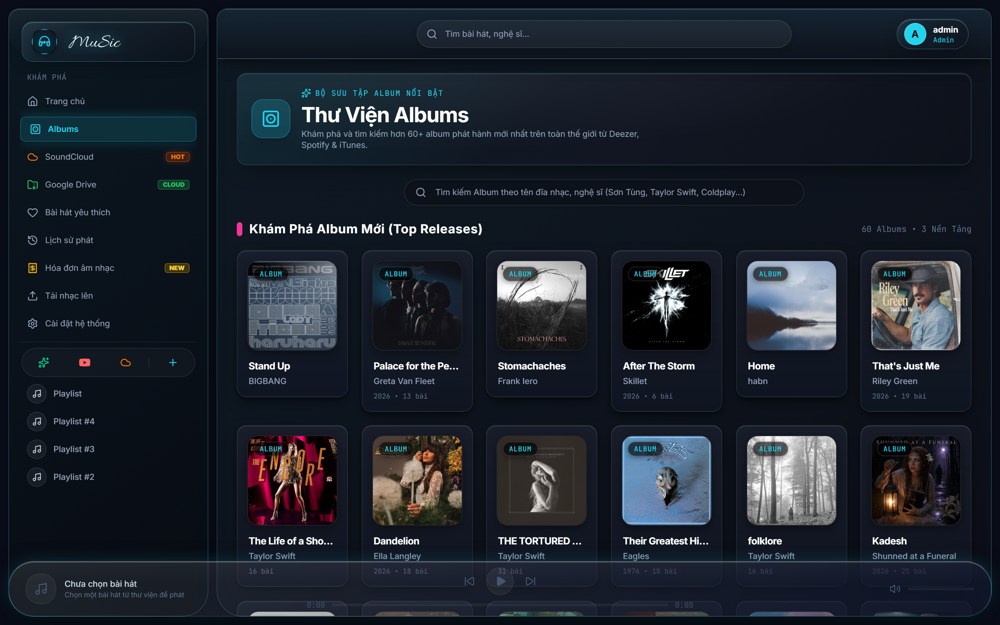
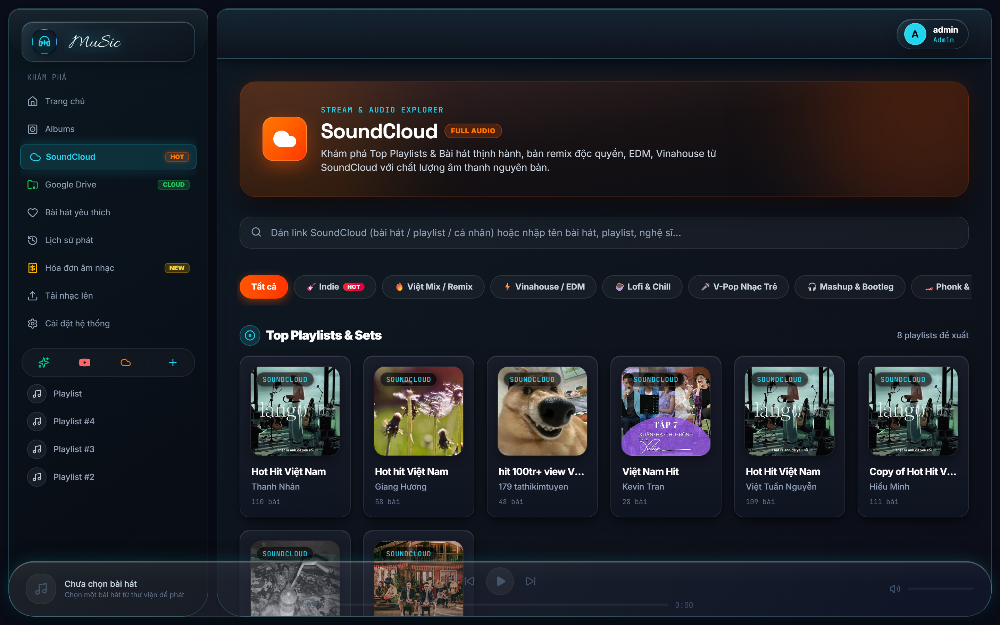
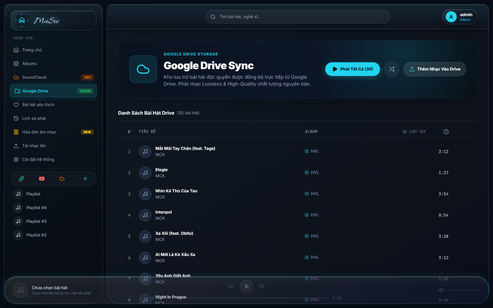
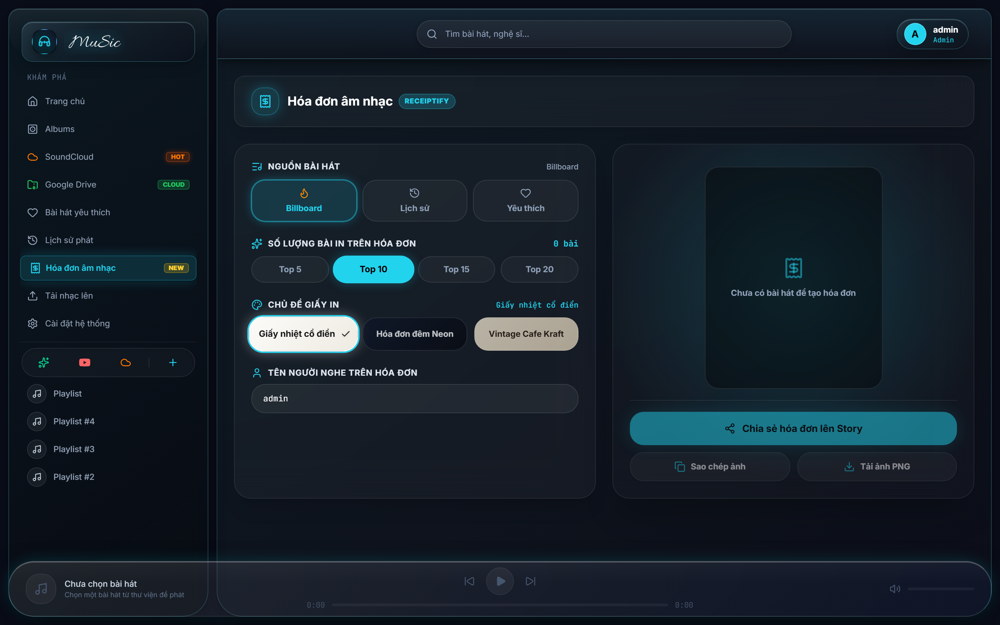
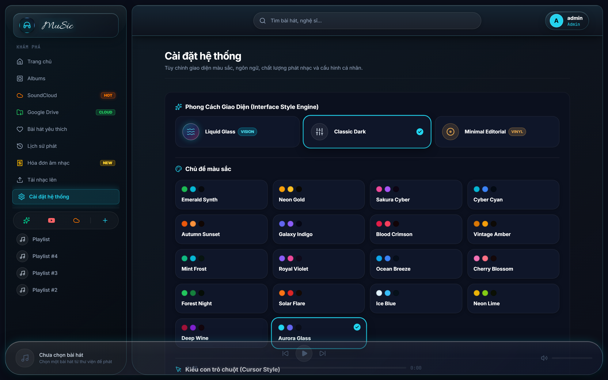
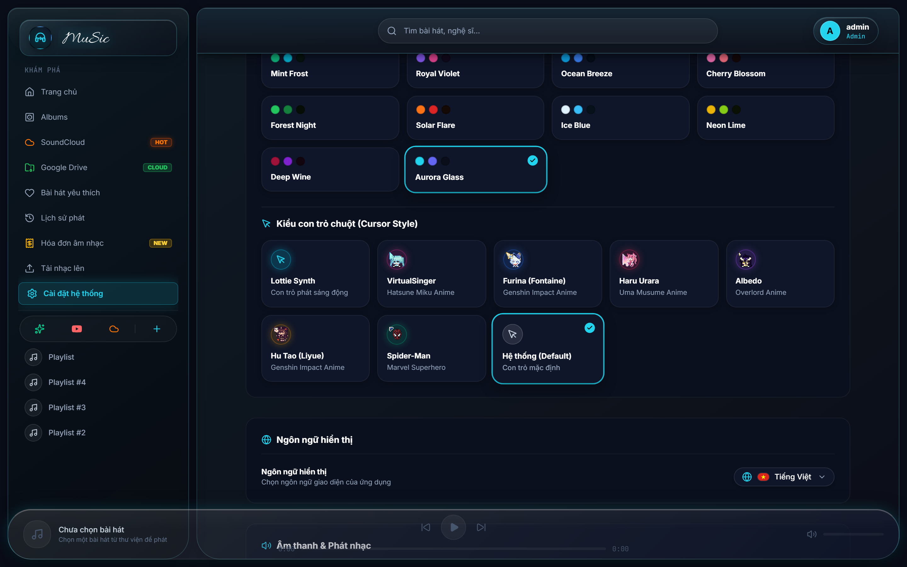
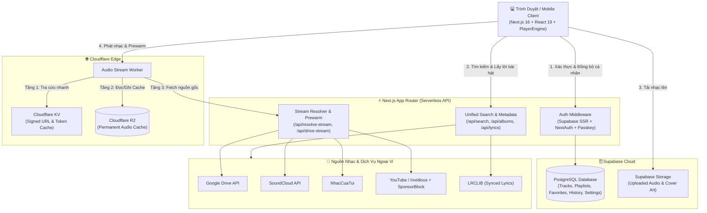

<div align="center">


# 🎵 MusicWeb

### Nền Tảng Nghe Nhạc Trực Tuyến Đa Nguồn & Cá Nhân Hóa Thế Hệ Mới

Một ứng dụng web nghe nhạc hiện đại được xây dựng trên **Next.js 16 (App Router)**, **React 19**, **Supabase**, **Cloudflare Workers (R2/KV)** và **Three.js**. Hợp nhất trải nghiệm phát nhạc từ nhiều nguồn (**SoundCloud, YouTube, NhacCuaTui, Google Drive Lossless, Local Upload**) cùng lời bài hát đồng bộ thời gian thực, hóa đơn âm nhạc **Receiptify**, hệ thống giao diện **Liquid Glass** và bộ sưu tập con trỏ chuột hoạt họa độc quyền.

[](https://nextjs.org/)
[](https://react.dev/)
[](https://www.typescriptlang.org/)
[](https://tailwindcss.com/)
[](https://supabase.com/)
[](https://workers.cloudflare.com/)
[](https://threejs.org/)

<br />

[**📸 Giao Diện Chính**](#-giao-diện-chính-screen-showcase) •
[**✨ Tính Năng Nổi Bật**](#-tính-năng-nổi-bật-key-features) •
[**🏗 Kiến Trúc**](#-kiến-trúc-hệ-thống-system-architecture) •
[**🛠 Công Nghệ**](#-công-nghệ-sử-dụng-tech-stack) •
[**🚀 Cài Đặt**](#-hướng-dẫn-cài-đặt-getting-started)

</div>

---

## 📸 Giao Diện Chính (Screen Showcase)

> 💡 *Nhấn vào bất kỳ hình ảnh nào để xem ở độ phân giải gốc (Retina 2880×1800).*

### 1. Trang Chủ Khám Phá & Sân Khấu Lời Bài Hát 3D

| 🏠 Trang Chủ & Khám Phá Đa Nguồn (`Home Dashboard`) | 🎤 Sân Khấu 3D & Lời Bài Hát Đồng Bộ (`Now Playing & Synced Lyrics`) |
| :---: | :---: |
|  |  |
| *Bảng xếp hạng Trending đa khu vực (Nhạc Việt, US-UK, K-Pop, C-Pop, J-Pop), tìm kiếm hợp nhất và thanh điều khiển PlayerBar.* | *Hiệu ứng hạt không gian 3D, đĩa nhạc xoay phát sáng, danh sách phát tiếp theo (Up Next) và lời bài hát LRC tự động cuộn kèm phiên âm Romaji.* |

---

### 2. Không Gian Âm Nhạc Đa Nền Tảng & Tiện Ích Độc Quyền

| 💿 Thư Viện Albums (`Albums Explorer`) | ☁️ Không Gian SoundCloud (`SoundCloud Hub`) |
| :---: | :---: |
|  |  |
| *Khám phá và tìm kiếm hơn 60+ album phát hành mới nhất từ Spotify, Deezer & iTunes với hiệu ứng thẻ 3D nghiêng (TiltCard).* | *Khám phá Top Playlists, bản Remix, Indie, Vinahouse/EDM, Lofi & Phonk trực tiếp từ SoundCloud hoặc dán link phát ngay.* |
| **📂 Kho Nhạc Đám Mây (`Google Drive Sync`)** | **🧾 Hóa Đơn Âm Nhạc (`Receiptify Studio`)** |
|  |  |
| *Đồng bộ và stream trực tiếp kho nhạc Lossless / High-Quality từ Google Drive qua hệ thống đệm Cloudflare R2 Edge Cache.* | *Tạo, tùy chỉnh chủ đề giấy in (Giấy nhiệt cổ điển, Đêm Neon, Vintage Kraft) và tải ảnh PNG biên lai thống kê bài hát.* |

---

### 3. Cá Nhân Hóa Giao Diện, Con Trỏ Hoạt Họa & Bảo Mật

| 🎨 Phong Cách Giao Diện & Chủ Đề (`Interface Style Engine`) | 🖱️ Con Trỏ Chuột Nhân Vật & Đa Ngôn Ngữ (`Custom Cursors`) |
| :---: | :---: |
|  |  |
| *Chuyển đổi 3 kiến trúc giao diện (**Liquid Glass Vision**, **Classic Dark**, **Minimal Editorial**) và hơn 14 bảng màu cảm xúc.* | *Bộ sưu tập con trỏ chuột Anime/Gaming (Lottie Synth, Hatsune Miku, Furina, Haru Urara, Albedo, Hu Tao, Spider-Man) và cài đặt đa ngôn ngữ.* |

<details>
<summary><b>🔐 Xem thêm: Giao Diện Đăng Nhập & Xác Thực Đa Lớp (Login & Passkey Auth)</b></summary>
<br />
<div align="center">
  
  <p><i>Giao diện đăng nhập nghệ thuật hỗ trợ Tài khoản mật khẩu, Google OAuth 2.0, WebAuthn Passkey và luồng phê duyệt Admin qua SMTP.</i></p>
</div>
</details>

---

## ✨ Tính Năng Nổi Bật (Key Features)

### 🎧 1. Phát Nhạc Đa Nguồn & Xử Lý Âm Thanh Thông Minh
* **Tìm Kiếm & Phát Hợp Nhất (Unified Multi-Source):** Kết hợp danh mục và luồng âm thanh từ **Spotify / Deezer / iTunes** (metadata & bảng xếp hạng), **SoundCloud**, **NhacCuaTui (NCT)** và **YouTube / Invidious**.
* **Google Drive Lossless Sync:** Đồng bộ thư mục nhạc cá nhân từ Google Drive, vượt giới hạn băng thông và giảm độ trễ nhờ cơ chế proxy & prewarm qua **Cloudflare Workers + R2/KV**.
* **Kho Nhạc Tải Lên (Local Upload):** Hỗ trợ tải lên `.mp3`, `.flac`, `.wav`, `.m4a` trực tiếp lên Supabase Storage, tự động bóc tách thẻ ID3 (tên bài, nghệ sĩ, album, ảnh bìa) ngay tại trình duyệt.
* **Tối Ưu Hóa Phát Nhạc:** Tự động bỏ qua đoạn giới thiệu/ngoài lề MV qua **SponsorBlock**, tự động điền hàng đợi thông minh (*Smart Fill Recommendation*) và đệm trước bài tiếp theo (*Adaptive Prewarm*).

### 🎨 2. Hệ Thống Giao Diện Đa Phong Cách (UI/UX Engine)
* **3 Phong Cách Thiết Kế (Interface Style Engine):**
  * **Liquid Glass (Vision):** Hiệu ứng kính lỏng khúc xạ đa lớp với nền chuyển động `LiquidAmbientCanvas`.
  * **Classic Dark:** Giao diện tối hiện đại với viền phát sáng neon theo chủ đề.
  * **Minimal Editorial (Vinyl):** Phong cách tạp chí cổ điển, ấm áp và tối giản.
* **14+ Chủ Đề Màu Sắc & Bộ Con Trỏ Chuột Độc Quyền:** Tùy chọn bảng màu (*Aurora Glass, Emerald Synth, Neon Gold, Sakura Cyber...*) và con trỏ chuột hoạt họa tự động tích hợp qua CLI (`npm run add-cursor`).
* **Chế Độ Chơi Game (Gaming Mode):** Tự động thu gọn toàn bộ DOM và hiệu ứng đồ họa để giải phóng RAM/GPU khi người dùng vừa nghe nhạc vừa chơi game.

### 🎤 3. Lời Bài Hát Đồng Bộ & Công Cụ Sáng Tạo
* **Lời Bài Hát Thời Gian Thực (Real-time Synced Lyrics):** Tự động tìm kiếm lời bài hát chuẩn `.lrc` từ LRCLIB, làm nổi bật câu đang hát với hiệu ứng trượt mượt mà và cho phép nhấn vào từng câu để tua nhạc.
* **Phiên Âm Tự Động (Romaji Transliteration):** Hỗ trợ hiển thị phiên âm Romaji cho các bài hát tiếng Nhật/Hàn/Trung ngay dưới dòng lời gốc.
* **Thẻ Chia Sẻ Lời Bài Hát (Lyrics Share Card):** Chọn các câu tâm đắc và xuất thành hình ảnh thẻ trích dẫn nghệ thuật để chia sẻ lên mạng xã hội.
* **Hóa Đơn Âm Nhạc (Receiptify Studio):** Tổng hợp Top 5 / 10 / 15 / 20 bài hát từ Bảng xếp hạng, Lịch sử nghe hoặc Yêu thích thành biên lai siêu thị in nhiệt cổ điển với mã vạch và thời gian thực.
* **Nhập Playlist Đa Nền Tảng (1-Click Import):** Nhập toàn bộ danh sách phát từ **Spotify**, **YouTube Playlist** hoặc **SoundCloud Set** về thư viện cá nhân chỉ bằng một đường dẫn.

### 🛡️ 4. Bảo Mật, Đa Ngôn Ngữ & Quản Trị
* **Xác Thực Đa Phương Thức:** Hỗ trợ đăng nhập bằng Email/Username, **Google OAuth (NextAuth)** và **WebAuthn Passkey**, kết hợp phân quyền **Supabase Row Level Security (RLS)**.
* **Luồng Phê Duyệt Admin & Thông Báo Hệ Thống:** Gửi email phê duyệt tài khoản mới qua SMTP (`Nodemailer`) và trình chỉnh sửa thông báo chào mừng trực tiếp cho Admin.
* **Đa Ngôn Ngữ (i18n):** Hỗ trợ chuyển đổi tức thì giữa Tiếng Việt, Tiếng Anh và các ngôn ngữ quốc tế.

---

## 🏗 Kiến Trúc Hệ Thống (System Architecture)



---

## 🛠 Công Nghệ Sử Dụng (Tech Stack)

| Tầng (Layer) | Công Nghệ Chính | Vai Trò Trong Hệ Thống |
| :--- | :--- | :--- |
| **Framework & UI** | [Next.js 16.2 (App Router)](https://nextjs.org/), [React 19.2](https://react.dev/), [TypeScript 5](https://www.typescriptlang.org/) | Kiến trúc Server/Client Components, định tuyến SPA mượt mà, kiểm tra kiểu tĩnh |
| **Styling & Hiệu Ứng** | [Tailwind CSS v4](https://tailwindcss.com/), [Framer Motion](https://www.framer.com/motion/), [Lucide React](https://lucide.dev/) | Thiết kế Liquid Glass, chuyển cảnh trang, hiệu ứng nghiêng 3D & nút bấm xúc giác |
| **Đồ Họa 3D & Hoạt Họa** | [Three.js](https://threejs.org/), `@react-three/fiber`, `lottie-web`, HTML5 Canvas | Sân khấu hạt 3D phản ứng theo tần số âm thanh, in biên lai Receiptify, con trỏ Lottie |
| **Xử Lý Âm Thanh** | Web Audio API, `music-metadata-browser`, `@breezystack/lamejs` | Phân tích phổ âm (Visualizer), đọc thẻ ID3 client-side, điều khiển đa luồng HTML5/YouTube |
| **Cơ Sở Dữ Liệu & Auth** | [Supabase (PostgreSQL & Storage)](https://supabase.com/), [NextAuth.js](https://next-auth.js.org/) | Lưu trữ dữ liệu người dùng với RLS, xác thực Google OAuth & Passkey |
| **Edge Caching** | [Cloudflare Workers](https://workers.cloudflare.com/), Cloudflare R2, Cloudflare KV | Tăng tốc độ phát nhạc đám mây, lưu đệm tệp âm thanh và giảm tải băng thông |
| **Kiểm Thử (Testing)** | [Vitest](https://vitest.dev/), [Playwright](https://playwright.dev/), [k6](https://k6.io/) | Unit test logic phát nhạc, kiểm thử tự động trình duyệt E2E và kiểm thử tải (Load testing) |

---

## 📂 Cấu Trúc Thư Mục (Project Structure)

<details>
<summary><b>📁 Nhấn để xem chi tiết cây thư mục dự án</b></summary>

```plaintext
MusicWeb/
├── app/                          # Next.js 16 App Router
│   ├── (app)/                    # Nhóm trang chính (dùng chung Sidebar, TopBar, PlayerBar)
│   │   ├── album/[id]/ & albums/ # Khám phá & xem chi tiết Album
│   │   ├── artist/               # Trang thông tin Nghệ sĩ
│   │   ├── drive/                # Kho nhạc đám mây Google Drive Sync
│   │   ├── favorites/            # Danh sách bài hát yêu thích
│   │   ├── history/              # Lịch sử nghe nhạc cá nhân
│   │   ├── lyrics/               # Trình xem lời bài hát đồng bộ
│   │   ├── playlist/[id]/        # Quản lý và phát Playlist cá nhân
│   │   ├── receipt/              # Studio tạo Hóa đơn âm nhạc (Receiptify)
│   │   ├── settings/             # Cài đặt giao diện, con trỏ, ngôn ngữ & âm thanh
│   │   ├── soundcloud/           # Không gian khám phá nhạc SoundCloud
│   │   ├── upload/               # Trang tải nhạc lên hệ thống (Admin)
│   │   └── page.tsx              # Trang chủ & Bảng xếp hạng Trending
│   ├── api/                      # Hệ thống Serverless API Routes
│   │   ├── albums/ & artist/     # Truy vấn thông tin đĩa nhạc & nghệ sĩ
│   │   ├── auth/ & passkey/      # Xác thực NextAuth, Supabase & Passkey
│   │   ├── drive-stream/         # Giải mã & stream nhạc từ Google Drive
│   │   ├── import-*/             # Nhập playlist từ Spotify, YouTube, SoundCloud
│   │   ├── lyrics/               # Tìm kiếm lời bài hát LRC & phiên âm Romaji
│   │   ├── resolve-stream/       # Bộ điều phối nguồn phát nhạc hợp nhất
│   │   └── ...
│   ├── login/ & register/        # Giao diện Đăng nhập, Đăng ký & Khôi phục mật khẩu
│   └── globals.css               # Hệ thống biến CSS, Theme Tokens & Liquid Glass
├── components/                   # Các thành phần giao diện tái sử dụng
│   ├── auth/                     # AuthGuard, AuthForm, CurrentUserContext
│   ├── common/                   # MediaCard, TiltCard, SkeletonLoader, MarqueeText
│   ├── i18n/                     # Đa ngôn ngữ (LanguageContext, LanguageSelector)
│   ├── modals/                   # Hộp thoại thông báo hệ thống (WelcomeAnnouncementModal)
│   ├── navigation/               # TopBar, MobileHeaderNav, ScrollContext
│   ├── player/                   # PlayerContext, PlayerBar, NowPlayingOverlay, LyricsView, ReceiptifyView
│   ├── playlist/                 # Quản lý Playlist & Modal nhập Playlist đa nguồn
│   ├── sidebar/                  # Thanh điều hướng bên trái (Sidebar)
│   ├── theme/                    # ThemeContext, ThemeSelector, LiquidAmbientCanvas, CustomCursor
│   └── track/                    # Danh sách bài hát (TrackList, TrackRow)
├── docs/                         # Tài liệu kiến trúc & ảnh chụp màn hình (docs/screenshots/)
├── lib/                          # Thư viện xử lý logic, bộ nhớ đệm, API clients & tiện ích
├── public/                       # Tài nguyên tĩnh (icons, cursors, manifest)
├── scripts/                      # Công cụ dòng lệnh (add-cursor.js, kiểm tra dữ liệu)
├── supabase/                     # Lược đồ cơ sở dữ liệu SQL (schema.sql) & RLS policies
├── tests/                        # Bộ kiểm thử E2E (Playwright) và kiểm thử hiệu năng (k6)
└── workers/ & worker/            # Mã nguồn Cloudflare Workers (Audio Stream & R2 Cache)
```

</details>

---

## 🚀 Hướng Dẫn Cài Đặt (Getting Started)

### 1. Yêu Cầu Hệ Thống
* **Node.js**: Phiên bản `20.x` trở lên
* **Trình quản lý gói**: `npm` (hoặc `pnpm` / `yarn` / `bun`)
* **Tài khoản Supabase**: Khởi tạo project miễn phí tại [supabase.com](https://supabase.com/)

### 2. Sao Chép Mã Nguồn & Cài Đặt Gói Phụ Thuộc

```bash
git clone https://github.com/PhongTCT/MusicWeb.git
cd MusicWeb

npm install
```

### 3. Thiết Lập Biến Môi Trường (`.env.local`)

Tạo tệp `.env.local` ở thư mục gốc dự án.

<details>
<summary><b>⚙️ Nhấn để xem mẫu cấu hình <code>.env.local</code> đầy đủ</b></summary>

```env
# ==============================================================================
# 1. SUPABASE CONFIGURATION
# ==============================================================================
NEXT_PUBLIC_SUPABASE_URL=https://your-project-id.supabase.co
NEXT_PUBLIC_SUPABASE_ANON_KEY=your-supabase-anon-key
NEXT_PUBLIC_SUPABASE_PUBLISHABLE_KEY=your-supabase-publishable-key
SUPABASE_SERVICE_ROLE_KEY=your-supabase-service-role-key

# ==============================================================================
# 2. AUTHENTICATION & GOOGLE OAUTH (NEXTAUTH)
# ==============================================================================
NEXTAUTH_URL=http://localhost:3000
NEXTAUTH_SECRET=your-random-secret-key
GOOGLE_CLIENT_ID=your-google-oauth-client-id
GOOGLE_CLIENT_SECRET=your-google-oauth-client-secret

# ==============================================================================
# 3. SMTP EMAIL (Dùng cho phê duyệt đăng ký & thông báo Admin)
# ==============================================================================
SMTP_HOST=smtp.gmail.com
SMTP_PORT=587
SMTP_USER=your-email@gmail.com
SMTP_PASS=your-gmail-app-password
ADMIN_PERSONAL_EMAIL=admin-receiver@gmail.com

# ==============================================================================
# 4. EXTERNAL STREAMING & CLOUDFLARE WORKERS (Tùy chọn)
# ==============================================================================
NEXT_PUBLIC_YOUTUBE_API_KEY=your-youtube-v3-api-key
NEXT_PUBLIC_DRIVE_STREAM_WORKER_URL=https://your-drive-worker.workers.dev
NEXT_PUBLIC_SOUNDCLOUD_WORKER_URL=https://your-soundcloud-worker.workers.dev
INTERNAL_RESOLVE_SECRET=your-internal-secret
```

</details>

### 4. Khởi Tạo Cơ Sở Dữ Liệu Supabase
1. Mở **Supabase Dashboard** → **SQL Editor**.
2. Sao chép nội dung tệp [`supabase/schema.sql`](supabase/schema.sql) và nhấn **RUN** để tạo các bảng (`user_profiles`, `tracks`, `playlists`, `playlist_tracks`, `favorite_tracks`, `listening_history`, `user_settings`) cùng các chính sách bảo mật RLS.
3. Trong mục **Storage**, tạo bucket tên `music-files` để lưu trữ nhạc tải lên.

### 5. Khởi Chạy Ứng Dụng

```bash
# Chạy máy chủ phát triển (http://localhost:3000)
npm run dev

# Build và khởi chạy bản Production
npm run build
npm run start
```

---

## 🧰 Công Cụ Mở Rộng & Kiểm Thử

<details>
<summary><b>⚡ Triển khai Cloudflare Audio Stream Worker (Tùy chọn)</b></summary>

Để tăng tốc độ phát nhạc từ Google Drive / SoundCloud thông qua bộ nhớ đệm biên (Edge Cache):

```bash
cd worker

# Khởi tạo KV Namespace & R2 Bucket
npx wrangler kv namespace create STREAM_URL_KV
npx wrangler r2 bucket create music-audio-cache

# Chạy thử nghiệm hoặc triển khai lên Cloudflare
npx wrangler dev
npx wrangler deploy
```

</details>

<details>
<summary><b>🖱️ Thêm nhân vật con trỏ chuột mới (Custom Cursor CLI)</b></summary>

Dự án đi kèm công cụ dòng lệnh giúp tự động quét, chuẩn hóa kích thước và đăng ký bộ con trỏ chuột mới (`.ani`, `.cur`, `.png`) vào hệ thống:

```bash
npm run add-cursor
```

</details>

<details>
<summary><b>🧪 Chạy bộ kiểm thử tự động (Unit & E2E Tests)</b></summary>

```bash
# Chạy Unit Tests với Vitest
npm test

# Chạy kiểm thử tự động trình duyệt E2E với Playwright
npm run test:e2e
```

</details>

---

## 📜 Giấy Phép (License)

Dự án được phân phối dưới giấy phép **MIT License**. Xem chi tiết tại tệp [LICENSE](LICENSE).

<div align="center">
  <br />
  
  <br />
  <sub>Được thiết kế và phát triển với niềm đam mê âm nhạc ❤️ bởi <a href="https://github.com/PhongTCT"><b>PhongTCT</b></a></sub>
</div>
