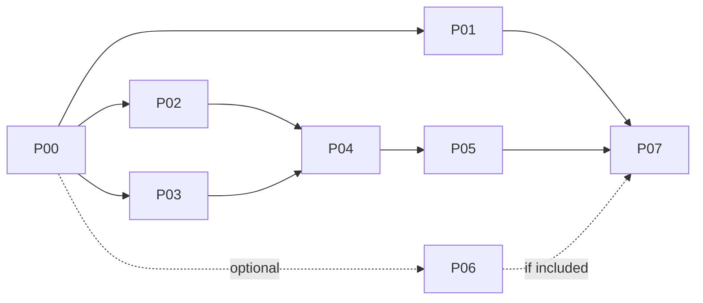

# MusicWeb IoC Refactor Implementation Plan

> **For agentic workers:** REQUIRED SUB-SKILL: Use `executing-plans` to implement the assigned part task-by-task. Use `subagent-driven-development` only when delegation is requested. Steps use checkbox syntax for tracking.

**Goal:** Bàn giao các phần refactor độc lập, có contract, test và thứ tự tích hợp rõ ràng.

**Architecture:** Factory + dependency injection thủ công, giữ facade public. Tách core khỏi SDK/React/browser; chuyển từng nhóm hành vi và test cùng lúc.

**Tech Stack:** Next.js 16.2.12, React 19.2.4, TypeScript 5, Vitest 4.1.10, Playwright 1.63.0; giữ nguyên dependencies đã cài.

## Global Constraints

Áp dụng nguyên văn toàn bộ Global Constraints của [design](../specs/2026-10-15-inversion-of-control-design.md). Baseline khảo sát là `c1dfc92`; mỗi agent phải kiểm tra lại HEAD và working tree trước khi sửa. Các file mới bên dưới là đích đề xuất, không phải file đã tồn tại.

**Đây là plan, chưa có task triển khai nào được đánh dấu hoàn thành.** Không chạy cả chương trình refactor chỉ vì được giao một phần.

Có công việc song song chưa commit trên resolver/SoundCloud trong lúc viết plan. Trước khi giao P01/P02, P00 phải ghi baseline mới và xác nhận các thay đổi đang làm đã ổn định. Đặc biệt kiểm tra SoundCloud L2 revalidation và YouTube `streamUrl`: không ép trở về behavior cũ trong ví dụ nếu baseline mới đã thay đổi. Nếu baseline làm thay đổi contract dependencies, cập nhật contract trong plan trước khi chia agent.

## Danh mục giao việc

| ID | Plan | Phụ thuộc | Kết quả độc lập |
|---|---|---|---|
| P00 | [Baseline và test map](2026-10-15-ioc-00-baseline.md) | Không | Baseline có bằng chứng và coverage map |
| P01 | [Server resolver](2026-10-15-ioc-01-server-resolution.md) | P00 | Route mỏng, server service có thể inject |
| P02 | [Client resolver](2026-10-15-ioc-02-client-resolution.md) | P00 | Resolver instance + facade cũ |
| P03 | [Playback ports và adapters](2026-10-15-ioc-03-playback-adapters.md) | P00 | Persistence/effects/transport test độc lập |
| P04 | [Playback core](2026-10-15-ioc-04-playback-core.md) | P02, P03 | Source service + controller test được, chưa thay provider |
| P05 | [React/browser integration](2026-10-15-ioc-05-react-integration.md) | P04 | Provider dùng controller; migration test hoàn chỉnh |
| P06 | [Search và Playlist](2026-10-15-ioc-06-search-playlist.md) | P00; nên sau P05 | Context phụ tách I/O, nghiệm thu riêng |
| P07 | [Integration verification](2026-10-15-ioc-07-verification.md) | P01, P02, P03, P04, P05 | Báo cáo tích hợp; thêm P06 nếu đã triển khai |



## Quy tắc chia agent và file ownership

- Có thể giao P01/P02/P03 cho ba agent sau P00. Với nhiều agent, ưu tiên worktree riêng; nếu chung checkout, chỉ sửa file được giao.
- P01 sở hữu `app/api/resolve-stream/**`, `lib/stream-resolution/server/**`; P02 sở hữu `lib/resolveStreamClient.ts`, `lib/stream-resolution/client/**`.
- P03 sở hữu adapters, `engines/**` và persistence scheduler; **chưa sửa `PlayerContext.tsx`**.
- P04 tạo `lib/playback/**`; chưa thay production wiring. P05 là agent duy nhất chuyển `PlayerContext.tsx`, contexts/progress store và browser hooks.
- P06 sở hữu Search/Playlist contexts và services, không sửa player.
- `lib/playbackPersistence.ts` giữ nguyên implementation trong P02/P03, dùng wrapper. Nếu thực sự phải sửa shared file, nêu contract change và bàn giao riêng; không đồng thời chỉnh ở hai nhánh.
- Không thêm barrel chung export cả client/server; không import server adapters từ player.
- File contract của từng phần thuộc agent tạo nó. Downstream cần thay chữ ký thì cập nhật plan và test caller trong cùng changeset.

## Trình tự mỗi task

1. Đọc spec, P00 coverage map và task; xác nhận dependency đã có trên HEAD.
2. Chạy baseline targeted tests, lưu kết quả thực tế.
3. Viết behavioral test cho seam mới; chạy để xác nhận failure đúng nguyên nhân.
4. Di chuyển logic tối thiểu, giữ policy/constants/order; chạy lại test liên quan.
5. Kiểm tra diff, typecheck, lint file thay đổi; ghi evidence và hạn chế.
6. Bàn giao một changeset nhỏ có thể review/revert. Chỉ commit nếu phiên thực thi cho phép ghi git; không dùng `git add .`.

## Định nghĩa hoàn thành

- Core có instance độc lập và dependency tường minh; không nhận một `env`/bag chứa toàn bộ refs/setters của provider.
- Existing caller không phải đổi URL, hook hoặc shape dữ liệu.
- Test behavior cũ được giữ hoặc thay bằng test tương đương; không chỉ xóa assertion source text để xanh.
- Fake time/network/storage đủ tái hiện race; không dùng sleep thật cho unit tests.
- Mỗi part nêu tests đã chạy, exit code, số pass/fail/skip, baseline failures và phần chưa kiểm chứng.
- Chưa chạy một check thì ghi `not run`, không ghi pass dựa trên báo cáo cũ.

## Prompt bàn giao có thể copy

```text
Triển khai riêng phần P01 theo docs/superpowers/plans/2026-10-15-ioc-01-server-resolution.md.
Đọc master plan docs/superpowers/plans/2026-10-15-ioc-refactor.md,
design docs/superpowers/specs/2026-10-15-inversion-of-control-design.md,
AGENTS.md và P00 baseline trước khi sửa.
Giữ nguyên behavior/public API; chỉ sửa file thuộc phần được giao.
Làm từng task và test, không tự mở rộng sang phần khác hoặc deploy/migrate DB.
Bàn giao diff, test evidence, thay đổi contract và các giới hạn còn lại.
```

Đổi P01 và đường dẫn tương ứng khi giao phần khác. Bắt đầu bằng P00 nếu baseline chưa được tạo; không bỏ qua bước này khi giao P01/P02/P03.

## Trạng thái

- [x] P00 baseline (failures/limits recorded in baseline report).
- [x] P01 server resolver (`lib/stream-resolution/server/**`, `app/api/resolve-stream/route.ts`).
- [x] P02 client resolver (`lib/stream-resolution/client/**`, `lib/resolveStreamClient.ts`).
- [x] P03 playback adapters (`lib/playback/ports.ts`, `components/player/adapters/**`, `components/player/engines/**`).
- [x] P04 playback core (`lib/playback/**`, `components/player/adapters/browserSourceDependencies.ts`).
- [x] P05 React/browser integration (`components/player/PlayerContext.tsx`, `usePlayerRuntime.ts`, `playerViewStore.ts`, `components/player/runtime/**`, behavioral test migration).
- [x] P06 Search/Playlist (`lib/search/**`, `lib/playlist/**`, `components/search/**`, `components/playlist/**`).
- [x] P07 nghiệm thu tích hợp (`docs/reviews/2026-10-15-ioc-verification.md`).
