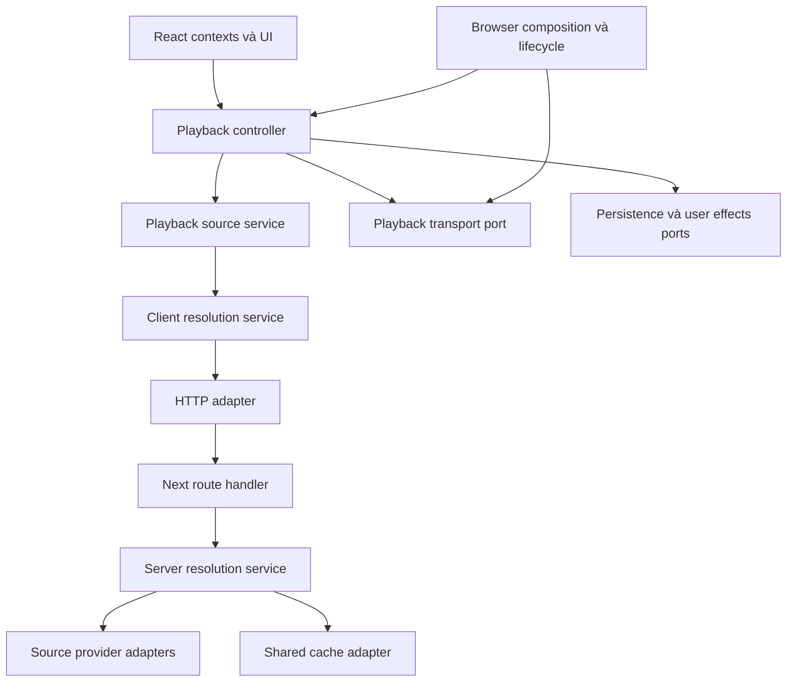

# MusicWeb: thiết kế refactor Inversion of Control

Ngày: 2026-10-15. Baseline khảo sát: `c1dfc92` (`update caching`).
Trạng thái: thiết kế và kế hoạch bàn giao; chưa triển khai production code, chưa chạy lại test.

**Working tree đang có công việc song song:** lúc hoàn thiện tài liệu xuất hiện thay đổi chưa commit ở resolver client/server, `lib/soundcloud.ts`, `lib/soundcloudClient.ts` và Worker SoundCloud. Những thay đổi đó không do bộ plan này tạo. P00 phải đóng băng baseline thực thi bằng HEAD + danh sách/hash diff; agent không được khôi phục source về mô tả `c1dfc92` nếu logic mới đã được chấp nhận.

## Mục tiêu và quyết định

Tách chính sách playback/resolution khỏi React, HTTP, storage và SDK để test trực tiếp, thay dependency dễ hơn và giảm phạm vi ảnh hưởng khi sửa. Dùng factory và dependency injection thủ công; không thêm DI container, decorator hoặc thư viện state machine.

Đã cân nhắc ba hướng:

1. **Tách từng module, giữ facade cũ — chọn hướng này.** Có thể review/revert từng phần, giữ nguyên API cho caller.
2. Chỉ chia `PlayerContext` thành nhiều custom hook: ít thay đổi nhưng nghiệp vụ vẫn gắn với React và khó test độc lập.
3. Rewrite toàn bộ bằng container/state machine: nhiều thay đổi đồng thời, khó xác định nguồn regression.

Đây là refactor bảo toàn hành vi. Các báo cáo audit cũ chỉ cung cấp tình huống kiểm chứng; không coi mọi phát hiện trong đó vẫn còn đúng ở baseline mới. Không gộp tối ưu latency, sửa thuật toán matching, đổi nguồn ưu tiên hoặc xử lý thêm lỗi iOS vào các PR extraction.

## Ranh giới đích

- **Domain/core:** nhận dependency qua tham số; không import React hooks, `next/server`, SDK Supabase, `window`, `document`, `navigator`, `localStorage` hoặc gọi `fetch` global.
- **Adapter:** giữ cách gọi SDK/API hiện tại, chuyển dữ liệu sang contract của core.
- **Composition:** nơi tạo instance và nối dependency. Client composition ở phía client; server composition ở route/server modules. Không chuyển service instance/function từ Server Component qua props serialize sang Client Component.
- **Facade:** giữ import path và chữ ký public hiện tại trong suốt migration.
- **Pure helpers:** giữ `playbackDecisions`, `playbackRaceGuards`, `queueSync`, matching và normalization; không tạo interface cho phép tính thuần.

## Bằng chứng hiện tại

| Vùng | Hiện trạng tại baseline | Ranh giới cần tách |
|---|---|---|
| `components/player/PlayerContext.tsx` | 4.634 dòng; state, playback, queue, engine, cache, persistence, Media Session | Controller, source service, browser lifecycle, adapters |
| `components/player/engines/types.ts` | Có `PlaybackEngine`, nhưng provider vẫn dùng concrete engines và native refs | Transport có ownership, native binding nằm ở browser adapter |
| `app/api/resolve-stream/route.ts` | 565 dòng; HTTP, source lookup, L1/in-flight, shared generation cùng file | HTTP facade + server service + source/cache adapters |
| `lib/resolveStreamClient.ts` | Module maps, interval, HTTP và persistence | Factory tạo instance, lifecycle rõ, facade tương thích |
| `components/player/__tests__/helpers/productionCallbacks.cjs` | Đọc AST, trích callback, chạy trong VM | Test controller qua public API và fake ports |
| `components/playlist/PlaylistContext.tsx` | HTTP, Realtime và confirm/alert trong context | Repository, subscription adapter, UI prompt |

## Global Constraints

- Giữ nguyên public hooks, context fields, API URLs, status codes và response JSON.
- Giữ nguyên cache keys/aliases, TTL, persistence schema và giao thức shared generation/RPC.
- Giữ Drive trước; sau đó race NCT/SoundCloud/YouTube với cửa sổ ưu tiên NCT 2200ms tại baseline.
- Không đổi thuật toán matching, retry budget, timeout hoặc prewarm policy trong PR extraction.
- Request cũ không được ghi đè track mới, làm phát lại sau Pause hoặc ghi cache sau invalidation.
- Giữ đường quick-play đồng bộ; không thêm await trước native play trên đường đã có URL.
- Giữ một playback owner; không để React refs và controller cùng là state authority.
- Giữ controls context ổn định và progress subscription riêng; không đưa timeupdate vào toàn bộ context tree.
- Dependency có tài nguyên phải có cleanup rõ; create phải không tự mở timer/listener/network.
- Không thêm package, thay DB schema/RLS/RPC, deploy hoặc gọi provider/live DB trong unit tests.
- Đọc tài liệu Next.js đi kèm `node_modules/next/dist/docs/` trước khi viết code framework.

## Những invariant phải có test

1. A resolve chậm, B được chọn sau: A không đổi source, queue, state hoặc pause B.
2. Pause trong resolve/retry/repeat/OS play: kết quả muộn không tự phát.
3. Invalidation client/server loại quyền publish của request cũ; phản hồi shared generation cũ không làm rollback epoch.
4. Late preferred source chỉ cải thiện cache trong generation hợp lệ; không đổi nguồn track đang phát.
5. Ended, watchdog và worker cùng báo completion: tối đa một lần chuyển bài cho owner hiện tại.
6. Đổi HTML5/YouTube dừng engine cũ; event cũ không được gắn token của track mới.
7. Queue next/previous/repeat/shuffle/search isolation và async smart-fill giữ semantics hiện tại.
8. Restore, 15 giây debounce, giới hạn 150 track, lifecycle flush và URL TTL giữ nguyên.
9. Cleanup idempotent; Strict Mode setup → cleanup → setup không tạo subscription trùng hoặc service đã chết.
10. Tạo hai service độc lập không chia sẻ cache/timer ngoài dependency được chủ động chia sẻ.

## Phạm vi và rủi ro

Core delivery là P00–P05 và P07 trong master plan. P06 (Search/Playlist) là phần mở rộng riêng, không chặn nghiệm thu playback. Không dùng số dòng `PlayerContext` làm tiêu chí duy nhất; kiểm tra dependency direction và hành vi.

Rủi ro lớn nhất là mất user gesture trên iOS, cleanup làm hỏng request mới, event native không xác định đúng owner, và test AST mất coverage khi di chuyển callback. Mỗi phần có test và thời điểm chuyển wiring riêng. Browser fixture không thay thế kiểm tra trên iPhone thật; service worker bị block trong config reliability hiện tại nên không được kết luận đã kiểm chứng service-worker keepalive.

## Tài liệu bắt buộc cho implementer

- `AGENTS.md`.
- `node_modules/next/dist/docs/01-app/01-getting-started/05-server-and-client-components.md`.
- `node_modules/next/dist/docs/01-app/01-getting-started/15-route-handlers.md`.
- `docs/superpowers/plans/2026-10-15-ioc-refactor.md` và plan được giao.
- `docs/superpowers/plans/2026-10-07-playback-remaining-limitations.md` để biết giới hạn kiểm chứng lịch sử; không kế thừa quyền commit/deploy hoặc kết quả test của phiên cũ.
